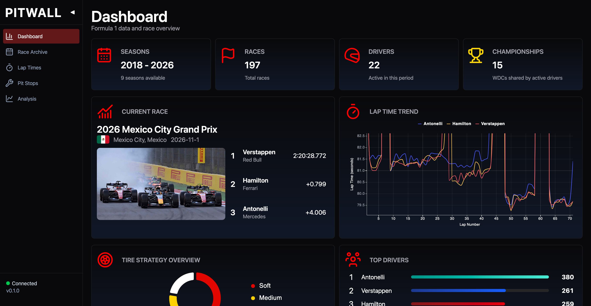

# Pitwall


Pitwall is a web-based Formula 1 data explorer built with React, TypeScript, and FastAPI. The project aims to make historical race data easier to explore and understand, with future capabilities for analyzing lap times, tire stints, and pit-stop strategies.

## Features

* **Historical Race Explorer:** Browse Formula 1 seasons and race events using historical data.
* **Lap Time Analysis:** Explore lap times and compare driver performance throughout a race.
* **Tire and Stint Analysis:** Examine tire compounds, stint lengths, and pit-stop transitions.
* **Race Replay:** Explore historical races lap by lap, including driver positions and pit stops.

*Features are planned and will be implemented incrementally as the project develops.*

## Screenshots

|  |  |  |
|:---:|:---:|:---:|
| **Dashboard** | **Race Archive** | **Strategy Simulator** |

## Tech Stack

* **Frontend:** React, TypeScript, Tailwind CSS, Vite
* **Backend:** Python, FastAPI
* **Historical Data:** FastF1
* **Data Processing:** Pandas
* **Development Tools:** Git, GitHub

## Setup Instructions

### Prerequisites

1.  **Clone the Repository:**
    ```bash
    git clone https://github.com/ldanielgg/pitwall.git
    cd pitwall
    ```
2.  **Set Up the Frontend:**
    ```bash
    cd frontend
    npm install
    npm run dev
    ```
    The frontend development server will be available at the local URL shown in your terminal, typically http://localhost:5173
    
4.  **Set Up the Backend:**\
   Open a separate terminal:
    ```bash
    cd backend
    python3 -m venv .venv
    source .venv/bin/activate
    pip install -r requirements.txt
    fastapi dev main.py
    ```
    The backend API will be available at http://127.0.0.1:8000
    
6.  **Verify the Backend:**\
   Open a separate terminal: http://127.0.0.1:8000/docs

## Project Status
Pitwall is currently in development. The initial focus is building the application foundation and integrating historical Formula 1 race data before adding analysis and simulation features.

Pitwall is an independent, unofficial project and is not affiliated with or endorsed by Formula 1 of the FIA.
